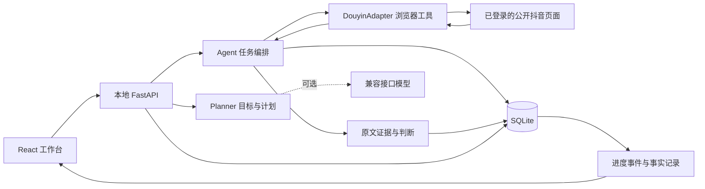

# Nomi 本地 Agent 架构

## 产品闭环

用户描述目标 → 规划器提出可编辑计划 → 用户确认执行范围 → 执行器观察公开内容 → 解析公开身份 → 按证据判断 → 保存客户与理由 → 生成话术 → 按授权渠道执行 → 观察页面反馈并记录。

前端保留 Nomi 的提需求、任务中心、结果中心、账号管理、知识库五项结构。正式入口使用真实 API，旧原型源码仅保留作设计参考，不初始化原来的演示客户。

## 模块边界

- `server/app.py`：HTTP 边界、输入校验、来源校验、错误处理、静态工作台服务。
- `server/models.py`：结构化任务、规划、发送输入。来源类型与发送渠道分别建模。
- `server/planner.py`：计划解析、缺项提问、证据匹配、基于知识的消息草稿。可选兼容模型接口，未配置时明确使用规则，不伪装模型结果。
- `server/agent.py`：执行循环、工具调度、进度记录、暂停/取消、每日任务调度、同一浏览器串行化。
- `server/adapter.py`：浏览器生命周期、真实登录状态、公开作品和评论、直播弹幕与主页、单条发送及页面结果核验。
- `server/browser_tools.py`：验证页截图观察、有效期与页面范围校验、单次点击/拖动。视觉判断与鼠标执行分离，规则模式不会自行猜测验证码。
- `server/inbox_adapter.py`：已知客户私信可见窗口读取，稳定身份核对、消息方向识别与未知结构拒绝。
- `server/conversations.py`：持久化会话、消息、规则决策及发送队列；历史基线、增量对齐、会话版本、人工接管和监听。
- `server/db.py`：持久化事实、事件、执行与客户，承担恢复与去重基础。
- `src/agent/`：真实工作台与 API 状态，不通过修改 localStorage 伪装执行成功。

## 为什么是 Agent

它不仅把按钮映射成脚本。规划器将用户目标转换成结构化执行计划；编排器在每轮观察后做匹配、保留不确定项、决定是否触达，并将工具失败、隐私设置、登录失效和取消反馈到执行记录。计划与事实分离，工具只返回观察证据，统计由已保存事件产生。

未配置大模型时，能力为规则驱动的工具 Agent，任意语义理解和推理能力不应夸大。配置模型也不能凭空补全地域、职业或意向证据。

## 事实和状态

- 用户标识以公开主页的稳定标识为依据，不按昵称合并。
- 客户可以有多条来源；保留原文、来源链接、观察时间与执行归属。
- 业务匹配区分符合、待核实、排除；普通互动不自动变为获客意向。
- 找人数是上限与目标，不是保证；不足时显示实际找到人数与原因。
- 生成话术、排队、尝试发送、页面显示已发送、已送达、已读是不同事实。
- 页面发送核验成功只表示当前页面有相应记录，不承诺送达或阅读。
- 模糊发送结果保留未知，禁止自动重发；恢复进程也不补发历史动作。
- 短视频评论与直播 @ 回复必须关联具体来源，不能以同名用户替代身份。
- 日程启用不等于执行中；执行中也不等于成功。

## 运行边界

本版为本机单用户、单抖音会话。一个执行锁协调采集、登录和发送，避免同一浏览器页面互相抢占。SQLite 与浏览器资料位于 `.data/`，不进入 Git；截图等证据保留在本地。

私信监听与长时间找客任务先采用分时执行。开启监听会暂停并终止当前找客执行，调度器在监听开启期间不启动新的找客任务。停止监听不会自动恢复找客。会话默认建议模式，逐会话授权自动模式；服务重启强制关闭监听。人工接管与关闭监听在真正提交私信前再次检查，已经提交的消息不可撤销。详见 [私信承接设计与当前落地范围](conversation-agent-design.md)。

前端只访问本地服务；浏览器凭证和模型密钥不传到前端。默认只监听 `127.0.0.1`。来源 URL 仅允许支持的抖音 HTTPS 域名，拒绝任意外部或本机文件地址。网页文本均视为数据，不能指示 Agent 改变执行范围或泄露资料。

这不是多租户云部署版本。要开放到公网，必须另建产品认证、用户隔离、凭证加密和部署访问控制；不要直接把本地端口暴露出去。

## 运行与验证

`npm run setup` 安装独立 Python 执行环境；Windows 使用 Edge，其他系统可安装 Playwright Chromium。`npm run dev` 同时启动前后端，`npm run build` 后 `npm start` 由本地后端提供工作台。

测试分为：领域和前端原型回归、后端状态与幂等行为、浏览器工具的本地页面验证、真实登录后的只读链路验证。测试替身只能用于测试，不能作为运行时客户来源。

抖音页面和权限可能变化。选择器失效、隐私限制、停播或验证页应成为明确失败/跳过记录；不使用虚构数据补齐结果。
